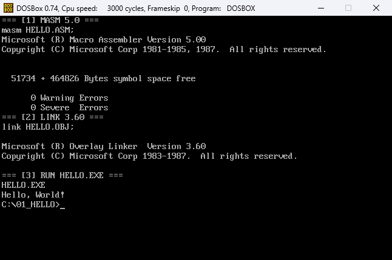
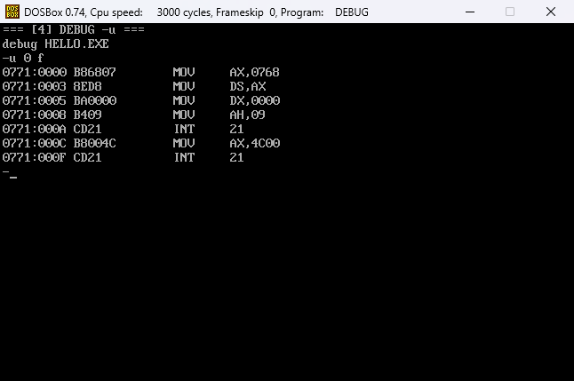
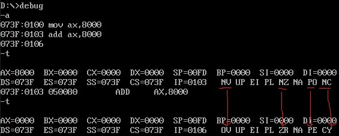

# 第一次作业：Hello, World!

## 题目

1. 传统方式：源代码经汇编、链接生成 EXE；用 `debug -u` 反汇编，查看机器码和源代码之间的对应关系；提交源代码和 EXE。
2. 另类方式：用 `debug -e` 把代码和数据直接写入内存并执行；提交文档。

## 文件

| 文件 | 说明 |
| --- | --- |
| `HELLO.ASM` / `HELLO.EXE` | 传统方式：DOS 09h 功能调用输出字符串 |
| `VIDEO.ASM` / `VIDEO.EXE` | 补充：不调用 DOS，直接把字符写入显存 B800h |
| `DEBUGMEM.TXT` | 另类方式：DEBUG 写内存、反汇编、单步和标志位观察 |
| `assets/build.png` | MASM 汇编、LINK 链接、运行 HELLO.EXE 的截图 |
| `assets/debug_u.png` | `debug -u` 反汇编 HELLO.EXE 的截图 |
| `assets/debug.jpg` | DEBUG 单步执行 `8000h + 8000h` 时的标志寄存器截图 |

## 环境准备

先按根目录 [README](../README.md) 的“环境准备”把仓库挂载为 C: 盘并设置 `PATH`，然后进入本题目录：

```bat
cd \01_Hello
```

`tools` 目录里已经带有 MASM 5.0、LINK 3.60 和 DEBUG。进入目录后可以先执行一次 `masm`，能显示版本信息就说明 `PATH` 设置正确。

## 汇编

```bat
masm HELLO.ASM;
```

命令末尾的分号表示后面的提示项都取默认值：生成 `HELLO.OBJ`，不生成 `.LST` 和 `.CRF` 文件。

执行成功时显示：

```text
Microsoft (R) Macro Assembler Version 5.00
...
      0 Warning Errors
      0 Severe  Errors
```

## 链接

```bat
link HELLO.OBJ;
```

LINK 根据 `HELLO.OBJ` 生成 `HELLO.EXE`。分号同样表示对象文件、可执行文件等提示项都使用默认值。

执行成功时显示：

```text
Microsoft (R) Overlay Linker  Version 3.60
...
```

链接完成后，当前目录下应能看到 `HELLO.OBJ` 和 `HELLO.EXE`。

## 运行

```bat
HELLO.EXE
```

输出：

```text
Hello, World!
```



`HELLO.ASM` 用 DOS 的 09h 功能显示以 `$` 结尾的字符串；字符串末尾的 `0dh, 0ah` 是回车换行。

## 反汇编对照

用 DEBUG 装入 EXE，从入口 `CS:IP` 开始反汇编：

```bat
debug HELLO.EXE
-u 0 f
-q
```

`-u 0 f` 表示反汇编偏移 `0000h` 到 `000Fh`，正好覆盖本程序的前 7 条指令。



截图中的机器码和源语句对应如下：

| 源语句 | 机器码 | 说明 |
| --- | --- | --- |
| `mov ax, data` | `B8 6B 07` | 数据段段地址，由 DOS 装载时重定位填入，实际值随环境变化 |
| `mov ds, ax` | `8E D8` | 把 AX 送 DS |
| `mov dx, offset msg` | `BA 00 00` | `msg` 在数据段内的偏移为 0 |
| `mov ah, 09h` | `B4 09` | 功能号 09h |
| `int 21h` | `CD 21` | 调用 DOS |
| `mov ax, 4c00h` | `B8 00 4C` | 功能号 4Ch，返回码 00h |
| `int 21h` | `CD 21` | 返回 DOS |

其中 `B8 6B 07` 中的 `076B` 是本次装载的数据段段地址；换一台机器或换一个 DOSBox 会话，这个值可能不同。`BA 00 00` 中的 `0000` 是 `msg` 在数据段内的偏移，和数据段装到哪里无关。

## 直接写显存（补充）

`VIDEO.ASM` 不调用 DOS 的显示功能，而是把字符码和属性直接写入彩色文本显存 `B800h`：

```bat
masm VIDEO.ASM;
link VIDEO.OBJ;
VIDEO.EXE
```

字符串写在第 13 行，程序退出后 DOS 提示符仍在第 1 行，不会覆盖它。因为内容不经过 DOS 输出，所以不能用 `>` 重定向抓取，需要直接看屏幕。

## DEBUG 写内存方式

`DEBUGMEM.TXT` 记录了另类方式的完整过程：

1. 用 `-e 0200 ...` 把 `Hello, World!$` 写入内存；
2. 用 `-e 0100 ...` 把 12 字节机器码写入 `CS:0100`；
3. 用 `-u 0100 010B` 反汇编检查；
4. 用 `-g` 运行，屏幕输出 `Hello, World!`；
5. 用 `-a` 输入 `mov ax,8000` / `add ax,8000`，用 `-t` 单步观察标志寄存器。



`8000h` 按有符号数解释是 `-32768`，两个负数相加得到 `-65536`，超出 16 位有符号范围，因此 `OF=1`（OV）；低 16 位结果是 `0000h`，符号位为 0，看起来像“负负得正”。同时无符号结果 `10000h` 超过 `FFFFh`，所以 `CF=1`（CY），并且 `ZF=1`、`PF=1`。
