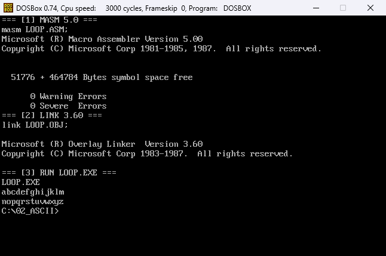
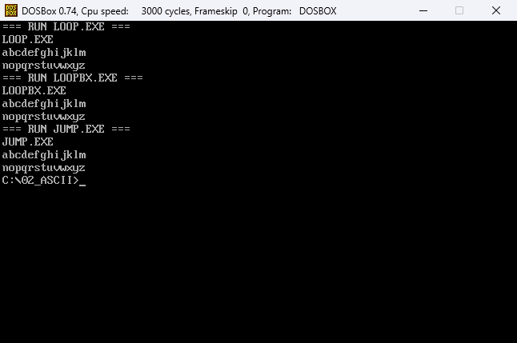

# 第二次作业：打印 ASCII 表

## 题目

输出 ASCII 表中的小写字母 `a`~`z`，每行 13 个字符。

1. 用 `loop` 指令实现，注意双重循环中 `CX` 值的保存和恢复。
2. 用条件转移指令实现。
3. 用 C 语言实现，查看反汇编代码并加注释。

## 文件

| 文件 | 说明 |
| --- | --- |
| `LOOP.ASM` / `LOOP.EXE` | 用 `loop`，进入内层前 `push cx`，内层结束后 `pop cx` |
| `LOOPBX.ASM` / `LOOPBX.EXE` | 用 `loop`，外层改用 `BH` 计数，避免占用 `CX` |
| `JUMP.ASM` / `JUMP.EXE` | 用 `cmp` + `jne` / `ja` 控制两层循环 |
| `ASCII.C` | C 语言实现 |
| `ASCII_C.TXT` | `gcc -m32 -O0` 反汇编后的逐行注释 |
| `assets/build.png` | 汇编、链接、运行 `LOOP.EXE` 的截图 |
| `assets/run.png` | 三个汇编程序运行结果的截图 |

## 环境准备

先按根目录 [README](../README.md) 的“环境准备”把仓库挂载为 C: 盘并设置 `PATH`，然后进入本题目录：

```bat
cd \02_ASCII
```

## 汇编与链接

### 1. LOOP 版本

```bat
masm LOOP.ASM;
link LOOP.OBJ;
```

`masm` 末尾的分号表示对象文件等提示项取默认值，生成 `LOOP.OBJ`；`link` 生成 `LOOP.EXE`。汇编成功时应显示 `0 Warning Errors`、`0 Severe Errors`。



### 2. LOOPBX 和 JUMP 版本

```bat
masm LOOPBX.ASM;
link LOOPBX.OBJ;
masm JUMP.ASM;
link JUMP.OBJ;
```

两个程序分别生成 `LOOPBX.EXE` 和 `JUMP.EXE`。它们的输出和 `LOOP.EXE` 完全一样，区别只在循环的控制方式：

- `LOOPBX.ASM`：外层用 `BH` 计数，`CX` 专供内层 `loop` 使用；
- `JUMP.ASM`：不用 `loop`，用 `cmp` + `jne`/`ja` 自己判断。

## 运行

```bat
LOOP.EXE
LOOPBX.EXE
JUMP.EXE
```

三个程序的输出都是：

```text
abcdefghijklm
nopqrstuvwxyz
```



## C 语言实现

在 Windows 的命令行（不是 DOSBox）中编译：

```bat
gcc -m32 -O0 -c ASCII.C -o ASCII.O
objdump -dr -Mintel ASCII.O
```

`-O0` 表示不做优化，保留源码中的两层循环，方便和汇编对照。`objdump` 的反汇编结果已经逐行加注释，保存在 `ASCII_C.TXT` 中。

C 程序运行后的输出同样是两行小写字母，可以直接用 `gcc -m32 ASCII.C -o ASCII.EXE` 编译运行；如果本机没有 32 位运行库，可以改用 64 位 gcc 编译，`ASCII_C.TXT` 里的注释按 32 位结果给出。

## 说明

`LOOP` 指令隐含使用 `CX` 作计数器。内层循环也要用 `CX` 时，外层计数可以改用 `BH`（`LOOPBX.ASM`），也可以在进入内层前 `push cx`、内层结束后 `pop cx`（`LOOP.ASM`）。

`JUMP.ASM` 里 `dec si`、`dec di` 之后用 `cmp` 和条件转移指令判断是否继续，不再依赖 `CX`，因此两层循环可以各用各的计数器。
