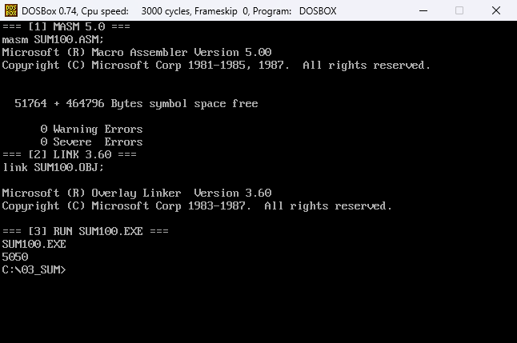
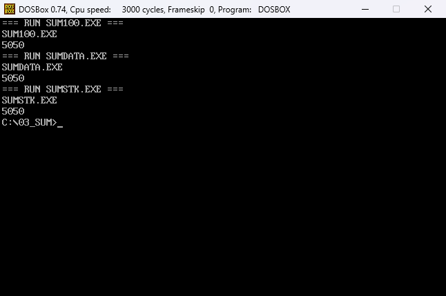
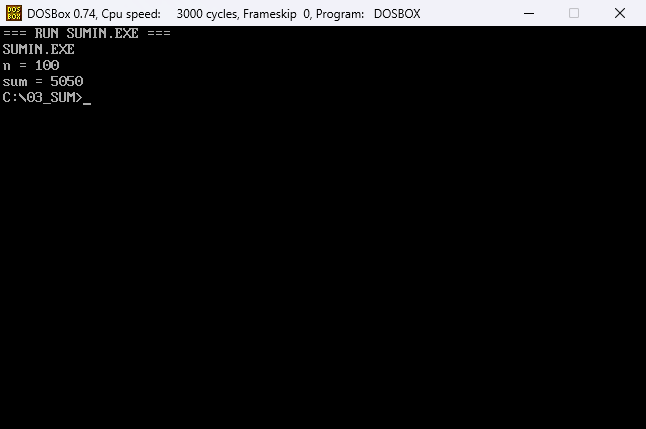

# 第三次作业：求和

## 题目

求 `1+2+...+100`，把结果 `5050` 输出到屏幕。

1. 把结果分别放在寄存器中、数据段中、栈中。
2. 用户输入 1~100 的整数 `n`，输出 `1+2+...+n` 的十进制结果（用 21h 中断的输入功能）。
3. 用 C 语言实现，查看反汇编代码并加注释。

## 文件

| 文件 | 说明 |
| --- | --- |
| `SUM100.ASM` / `SUM100.EXE` | 结果放在 `AX` 中 |
| `SUMDATA.ASM` / `SUMDATA.EXE` | 结果放在数据段变量 `total` 中 |
| `SUMSTK.ASM` / `SUMSTK.EXE` | 结果放在栈上预留的一个字中 |
| `SUMIN.ASM` / `SUMIN.EXE` | 输入 1~100，求和后输出 |
| `SUM.C` | C 语言实现 |
| `SUM_C.TXT` | `gcc -m32 -O0` 反汇编后的逐行注释 |
| `assets/build.png` | 汇编、链接、运行 `SUM100.EXE` 的截图 |
| `assets/run.png` | 三种存放方式运行结果的截图 |
| `assets/run_input.png` | SUMIN 输入 100 的运行结果（n = 100，sum = 5050） |

## 环境准备

先按根目录 [README](../README.md) 的“环境准备”把仓库挂载为 C: 盘并设置 `PATH`，然后进入本题目录：

```bat
cd \03_Sum
```

## 汇编与链接

先编译“结果放在寄存器”的版本：

```bat
masm SUM100.ASM;
link SUM100.OBJ;
```

`masm` 生成 `SUM100.OBJ`，`link` 生成 `SUM100.EXE`。成功时显示 `0 Warning Errors`、`0 Severe Errors`。



三个求和程序的源码结构相同，只是累加结果的存放位置不同，编译命令分别是：

```bat
masm SUMDATA.ASM;
link SUMDATA.OBJ;
masm SUMSTK.ASM;
link SUMSTK.OBJ;
masm SUMIN.ASM;
link SUMIN.OBJ;
```

## 运行：三种存放方式

```bat
SUM100.EXE
SUMDATA.EXE
SUMSTK.EXE
```

三个程序都输出：

```text
5050
```



- `SUM100.ASM`：用 `AX` 保存累加和；
- `SUMDATA.ASM`：用数据段的 `total` 变量保存，每次 `add total, bx`；
- `SUMSTK.ASM`：用 `sub sp, 2` 在栈上预留一个字，`BP` 指向该单元，每轮从 `[bp]` 取出、累加、存回。

三个程序的十进制输出子程序相同：反复除以 10，把余数压栈，除到商为 0 后再依次弹出，转成 ASCII 输出。

## 运行：输入求和

```bat
SUMIN.EXE
```

屏幕先显示提示：

```text
n = 
```

输入 `100` 后回车，输出：

```text
n = 100
sum = 5050
```



`SUMIN` 用 INT 21h 的 `0Ah` 功能读取一行。`0Ah` 缓冲区的格式是：

- 第 1 字节：最多允许输入的字符数，**包含结尾的回车**；
- 第 2 字节：DOS 返回的实际字符数；
- 从第 3 字节开始：输入的字符。

因此 `SUMIN.ASM` 的缓冲区定义是 `buf db 4, 0, 4 dup(0)`：4 个字符位置可以容纳 `100` 三个数字加一个回车。输入后程序把字符逐个转成数字，检查范围 1~100，再求和并输出。

## C 语言实现

在 Windows 的命令行中编译：

```bat
gcc -m32 -O0 -c SUM.C -o SUM.O
objdump -dr -Mintel SUM.O
```

`-O0` 保留源码中的循环结构，方便和汇编对照。反汇编结果已经逐行加注释，保存在 `SUM_C.TXT` 中。

## 说明

- 5050 小于 65535，用 16 位无符号数保存即可，不会溢出。
- 十进制输出不能直接把数字送屏幕，必须先转成 ASCII 字符；除以 10 得到的余数是个位，所以要用栈把顺序倒过来。
- `SUMIN` 的范围检查在解析完输入后进行：小于 1 或大于 100 会提示 `n must be 1..100` 并重新输入。
