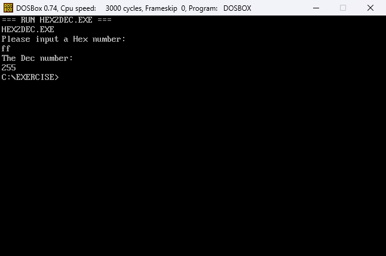
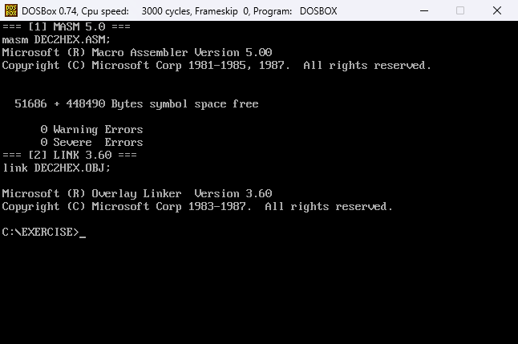
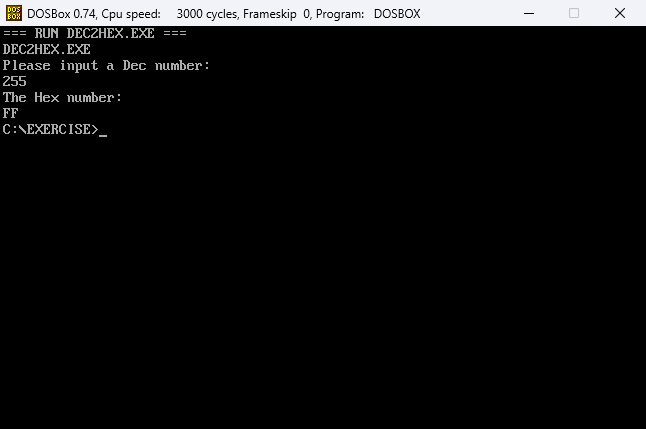

# 小练习：进制转换

## 题目

基本要求：输入 1~2 位十六进制数，输出对应的十进制数。

追加要求：实现十进制到十六进制的转换。

## 文件

| 文件 | 说明 |
| --- | --- |
| `HEX2DEC.ASM` / `HEX2DEC.EXE` | 十六进制转十进制 |
| `DEC2HEX.ASM` / `DEC2HEX.EXE` | 十进制转十六进制（0~65535） |
| `assets/build_hex2dec.png` | 汇编、链接 `HEX2DEC.ASM` 的截图 |
| `assets/hex2dec.png` | HEX2DEC 输入 ff 的运行结果（255） |
| `assets/build_dec2hex.png` | 汇编、链接 `DEC2HEX.ASM` 的截图 |
| `assets/dec2hex.png` | DEC2HEX 输入 255 的运行结果（FF） |

## 环境准备

先按根目录 [README](../README.md) 的“环境准备”把仓库挂载为 C: 盘并设置 `PATH`，然后进入本目录：

```bat
cd \Exercise
```

## 十六进制转十进制

### 汇编和链接

```bat
masm HEX2DEC.ASM;
link HEX2DEC.OBJ;
```

`masm` 生成 `HEX2DEC.OBJ`，`link` 生成 `HEX2DEC.EXE`。成功时显示 `0 Warning Errors`、`0 Severe Errors`。


### 运行

```bat
HEX2DEC.EXE
```

输入 `ff` 后回车，屏幕显示：

```text
Please input a Hex number:
ff
The Dec number:
255
```



程序逐位处理输入：每读一位，先把小写字母转成大写，再把字符转成 0~15 的数字，执行 `结果 = 结果 * 16 + 该位数字`。乘以 16 用 `shl bx, 4` 实现。最后调用十进制输出子程序，把 `BX` 中的结果打印出来。

## 十进制转十六进制

### 汇编和链接

```bat
masm DEC2HEX.ASM;
link DEC2HEX.OBJ;
```

生成 `DEC2HEX.EXE`。



### 运行

```bat
DEC2HEX.EXE
```

输入 `255` 后回车，屏幕显示：

```text
Please input a Dec number:
255
The Hex number:
FF
```



程序把十进制字符逐个转成数字，执行 `数值 = 数值 * 10 + 该位数字`，并检查结果是否超出 16 位。输出时从高到低每次取 4 位：用 4 条 `rol bx, 1` 把高 4 位移到低 4 位，屏蔽成 0~15，再转成 `0`~`9`、`A`~`F`。前导零会跳过，但数值为 0 时仍输出一个 `0`。

## 说明

- 两个程序都用 INT 21h 的 `0Ah` 功能读入一行。`0Ah` 缓冲区第 1 字节是最大字符数，**包含结尾的回车**，所以 `HEX2DEC` 的 `inbuf db 3` 可以输入 2 位十六进制数，`DEC2HEX` 的 `inbuf db 6` 可以输入 5 位十进制数。
- 十六进制转十进制时，输入既可以是大写 `A`~`F`，也可以是小写 `a`~`f`。
- 十进制转十六进制支持 `0`~`65535`；输入非法字符或超出 16 位会提示 `Not a Dec number! Try again.` 并重新输入。
